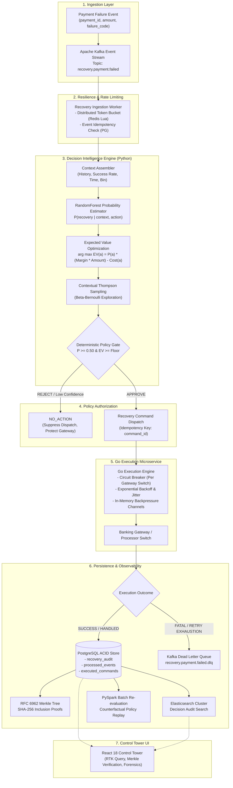

<div align="center">

# ⚡ Autonomous Payment Revenue Recovery Engine

### *Enterprise-Grade Autonomous Decisioning, Distributed Execution, and Cryptographic Auditability for Payment Failures*

<br/>

[](https://github.com/uday68/payment-recovery-engine/actions/workflows/ci.yml)
[](https://python.org)
[](https://go.dev)
[](https://react.dev)
[](https://kafka.apache.org)
[](https://postgresql.org)
[](https://redis.io)
[](https://elastic.co)
[](https://spark.apache.org)
[](LICENSE)

<br/>

**Production-grade payment recovery platform combining machine-learning probability estimation, expected economic value optimization ($EV(a)$), multi-armed bandit exploration, deterministic safety guardrails, high-throughput Go execution, and RFC 6962 cryptographic Merkle audit ledgers.**

</div>

---

## Table of Contents

- [1. Executive Summary & Core Insight](#1-executive-summary--core-insight)
- [2. System Architecture & Topology](#2-system-architecture--topology)
- [3. Decision Science & Mathematical Foundations](#3-decision-science--mathematical-foundations)
- [4. Distributed Systems & Reliability Engineering](#4-distributed-systems--reliability-engineering)
- [5. Auditing, Cryptography & Search Infrastructure](#5-auditing-cryptography--search-infrastructure)
- [6. Batch Policy Re-Evaluation Engine (PySpark)](#6-batch-policy-re-evaluation-engine-pyspark)
- [7. Empirical Verification & Benchmark Matrix](#7-empirical-verification--benchmark-matrix)
- [8. Repository Architecture & Layout](#8-repository-architecture--layout)
- [9. Run Locally & Quickstart](#9-run-locally--quickstart)
- [10. Production Standards & Quality Gates](#10-production-standards--quality-gates)
- [11. Scope Boundaries & Known Limitations](#11-scope-boundaries--known-limitations)
- [12. Governance & Security](#12-governance--security)

---

## 1. Executive Summary & Core Insight

Payment transaction declines are not merely failed database records — they represent **immediate revenue at risk**, heightened customer friction, and merchant churn.

### The Naive Engineering Anti-Pattern
Traditional payment stacks utilize static rule engines or unconstrained retry loops:
* **Immediate Retries:** Spamming card networks when bank switches are experiencing downtime violates scheme rules (Visa/Mastercard excessive retry limits) and risks merchant terminal blacklisting.
* **Blind Inaction:** Failing to re-engage recoverable payments (e.g. temporary rate limits, network timeouts, transient balance issues) leaks recoverable gross merchandise value (GMV).
* **Static Heuristics:** Hardcoded failure-code mappings fail to adapt to real-time issuer switch health, cardholder payment context, or variable fee structures.

### The System Solution
This platform addresses payment recovery as a **constrained stochastic optimization problem**:

> **"Which intervention maximizes expected net economic recovery value, subject to strict policy guardrails, distributed rate limits, and zero double-execution risk?"**

```
Failed Payment Event ──► Probability Estimation ──► Economic Value Optimization ──► Thompson Sampling ──► Deterministic Policy Gate ──► Resilient Execution
```

**Key Architectural Invariant:** Machine learning models only generate non-binding recommendations. Execution authority resides strictly in deterministic policy gates and idempotent execution workers.

---

## 2. System Architecture & Topology

The platform is architected as an asynchronous, event-driven distributed system separating decision intelligence (Python/FastAPI) from high-throughput execution (Go) and immutable audit persistence (PostgreSQL WAL, RFC 6962 Merkle Trees, and Elasticsearch).



---

## 3. Decision Science & Mathematical Foundations

### 3.1 Problem Formulation
For every failed payment transaction, let:
* $X \in \mathcal{X}$: Context vector (customer transaction history, historical recovery rate, payment method, issuer bank code, failure category, hour of day).
* $A = \{\text{RETRY\_NOW}, \text{RETRY\_LATER}, \text{SEND\_REMINDER}, \text{NO\_ACTION}\}$: Finite action space.
* $Y \in \{0, 1\}$: Binary recovery outcome.
* $M \in (0, 1]$: Merchant recovery margin (e.g. $1.0$ for gross merchant recovery, $0.02$ for payment aggregator MDR).
* $C(a)$: Direct intervention fee tariff:
  $$\text{Cost}(\text{RETRY\_NOW}) = \text{₹}2.00, \quad \text{Cost}(\text{RETRY\_LATER}) = \text{₹}2.00, \quad \text{Cost}(\text{SEND\_REMINDER}) = \text{₹}1.00, \quad \text{Cost}(\text{NO\_ACTION}) = \text{₹}0.00$$

The supervised learning model estimates the conditional recovery probability for each candidate action:
$$P(Y = 1 \mid X, a)$$

### 3.2 Expected Net Economic Value Optimization
The system selects candidate actions by maximizing estimated net recovery profit:

$$EV(a) = \begin{cases} 
0.0 & \text{if } a = \text{NO\_ACTION} \\ 
P(Y = 1 \mid X, a) \cdot (M \times \text{Amount}) - C(a) & \text{otherwise} 
\end{cases}$$

$$a^* = \arg\max_{a \in A} EV(a)$$

If all active money-moving actions generate negative expected return (e.g., low-amount micro-transactions with high decline likelihood), the optimizer mathematically defaults to $a^* = \text{NO\_ACTION}$.

### 3.3 Contextual Thompson Sampling (Exploration vs. Exploitation)
To prevent model stagnation and continuously discover changing gateway behaviors, the engine incorporates a Bayesian multi-armed bandit layer. For each failure code cohort $c$ and action $a$, parameters $\alpha_{c,a}$ and $\beta_{c,a}$ maintain Beta posteriors over success rates:

$$\theta_{a} \sim \text{Beta}(\alpha_{c, a},\, \beta_{c, a})$$

The sampled posterior $\theta_{a}$ blends with the supervised model probability $\hat{p}(a)$ to dynamically explore non-consensus actions without sacrificing baseline safety.

### 3.4 Deterministic Policy Guardrails
The machine learning recommendation $a^*$ is evaluated by a hard policy engine before execution authorization:
1. **Confidence Floor:** If $a \in \{\text{RETRY\_NOW}, \text{RETRY\_LATER}\}$ and $P(Y=1 \mid X, a) < 0.50$, the command is **BLOCKED** and replaced with $\text{NO\_ACTION}$.
2. **Economic Floor:** If $EV(a) < \text{₹}50.00$ on credit/debit interventions, retries are suppressed to conserve processing budgets.
3. **Emergency Circuit:** An administrator can globally suspend automated money-moving dispatch via `/v1/recovery/policies/config`.

---

## 4. Distributed Systems & Reliability Engineering

### 4.1 Strict State Lifecycle & Distributed Lease Idempotency
Payment networks must never double-debit or double-retry. The platform provides two distinct, audited tiers of idempotency:
1. **Durable Event State Lifecycle:** Rather than a naive presence check, event processing follows an atomic lease-based state machine:
   * **`PROCESSING`:** The worker claims the event using `ClaimOrRenew()` with a worker lease ID and expiration timestamp (`NOW() + 30s`). If another worker attempts to claim an active lease, `ErrEventInProgress` is returned and the Kafka offset is **NOT** committed, ensuring redelivery if the original worker crashes.
   * **`COMPLETED`:** Marked durably upon successful command execution. Duplicate redeliveries immediately return `AlreadyCompleted`, allowing safe Kafka offset commitment without re-executing.
   * **`FAILED` & Bounded Retries:** If execution fails, the state transitions to `FAILED` and releases the lease. Subsequent workers re-claim and increment `retry_count`. If `retry_count >= max_retries`, the event is permanently diverted to the Dead-Letter Queue (DLQ) and the offset is committed to prevent poison-pill partition stalling.
2. **Command Execution Idempotency:** Every dispatch command generates a deterministic UUID `command_id = SHA256(payment_id + action + attempt)`. The Go executor claims this key in PostgreSQL using atomic SQL transactions:
   ```sql
   INSERT INTO command_idempotency (command_id) VALUES ($1) ON CONFLICT (command_id) DO NOTHING RETURNING command_id;
   ```

### 4.2 Distributed Token Bucket Rate Limiting
To protect upstream banking switches from synchronized retry surges, rate limiting is implemented via atomic Redis Lua scripts:
* Evaluated dynamically per issuer bank (`limit:bank:{HDFC}`) and payment method (`limit:method:{UPI}`).
* Supports burst allowances with continuous token replenishment.
* If Redis is unreachable, the system fails open safely with local sliding-window in-memory limiters to maintain availability.

### 4.3 Cascading Failure Protection (Circuit Breakers)
Every outbound gateway client in Go is wrapped in an adaptive Three-State Circuit Breaker (`Closed`, `Open`, `Half-Open`):
* **Trip Condition:** 5 consecutive failures or error rate $> 50\%$ within a rolling 30-second window transitions state to `Open`.
* **Fast-Failure:** Requests routed to an `Open` gateway fail immediately with $0\text{ms}$ latency, allowing the fallback scheduler to queue transactions for off-peak recovery (`RETRY_LATER`).
* **Hysteresis Recovery:** After a 60-second cooldown, the breaker enters `Half-Open`, allowing a single trial request to verify upstream switch restoration.

### 4.4 Dead Letter Queue (DLQ) Two-Phase Commit
Kafka consumers adhere strictly to reliable messaging invariants:
* Messages that encounter poison-pill unparseable JSON or reach maximum bounded retries (3 attempts) are mirrored into `recovery.payment.failed.dlq` with full diagnostic failure headers.
* **Invariant:** The consumer **never** commits the primary partition offset until Kafka returns an `acks=all` acknowledgment from the DLQ topic.

---

## 5. Auditing, Cryptography & Search Infrastructure

### 5.1 RFC 6962 Cryptographic Merkle Tree
To guarantee non-repudiation and regulatory audit compliance, every logged recovery decision is appended to an in-memory and database-backed Merkle audit log conforming to RFC 6962 (Certificate Transparency standard):
* **Domain Separation:** Leaf hashes prefix data with `0x00`; internal node hashes prefix children digests with `0x01` to prevent second preimage attacks:
  $$\text{Leaf Hash} = \text{SHA-256}(0x00 \,\|\, \text{CanonicalAuditRecord})$$
  $$\text{Node Hash} = \text{SHA-256}(0x01 \,\|\, \text{LeftChildHash} \,\|\, \text{RightChildHash})$$
* **Inclusion Proofs:** `/v1/audit/proof/{payment_id}` yields an $O(\log N)$ cryptographic audit path, independently verifiable via `/v1/audit/verify-proof`.

### 5.2 Real-Time Decision Audit Search & Multi-Tier Fallback
The engine provides low-latency search across millions of historical decision records:
* **Primary Query Engine:** Elasticsearch 8 indexes all audit dimensions (`payment_id`, `customer_id`, `failure_code`, `chosen_action`, `expected_value`, `policy_allowed`, `execution_result`, `timestamp`).
* **Dynamic Query DSL:** [`backend/elasticsearch_client.py`](backend/elasticsearch_client.py) constructs optimized bool queries with multi-match relevance scoring and aggregations (`by_action`, `by_outcome`).
* **Resilient Dual Fallback:** If the Elasticsearch cluster is unavailable or unprovisioned, the search endpoint seamlessly falls back to PostgreSQL SQL window aggregations, and subsequently to a process-wide in-memory ledger if the database is offline.

---

## 6. Batch Policy Re-Evaluation Engine (PySpark)

Located in [`batch/policy_replay/`](batch/policy_replay/), this offline processing module enables quantitative backtesting of alternative recovery policies against historical payment decision datasets.

```bash
# Run local PySpark batch re-evaluation on historical CSV export
python batch/policy_replay/replay_job.py --input tests/fixtures/sample_decisions.csv --margin 1.0
```

### Capabilities
* Replays 4 policies simultaneously (`Always Retry`, `Naive Rule`, `Expert Rule`, `Current AI Engine`).
* Calculates counterfactual gross recoveries, direct operational costs, expected net economic value ($EV$), and policy suppression rates.
* **Verified Agreement:** Validated by unit tests ([`tests/test_policy_replay.py`](tests/test_policy_replay.py)) proving that PySpark partition execution (`mapPartitions`) and pure Python sequential execution yield identical mathematical results.

---

## 7. Empirical Verification & Benchmark Matrix

> [!IMPORTANT]
> **Data Transparency Notice:** All machine learning models, statistical significance tests, and 4-way strategy comparisons reported below were generated on **synthetic payment datasets** via parametric simulation (`ml/data.csv`, 61,520 records across 3,076 unique payment entities). No real merchant or cardholder PII is contained in this repository.

### 7.1 Cross-Validation Performance (5-Fold GroupKFold)
Evaluated via `python run_ml_audit.py`. Groups are partitioned strictly by `payment_id` ($\text{Train} \cap \text{Test} = \emptyset$) to prevent counterfactual leakage:

| Model Architecture | ROC-AUC | PR-AUC | Brier Score Loss | Log Loss | ECE | Production Status |
| :--- | :---: | :---: | :---: | :---: | :---: | :---: |
| **Dummy (Prior Baseline)** | $0.5000 \pm 0.0000$ | $0.3310 \pm 0.0048$ | $0.2214 \pm 0.0016$ | $0.6349 \pm 0.0033$ | $0.0045 \pm 0.0039$ | Baseline Reference |
| **Logistic Regression (L2)** | $0.7697 \pm 0.0029$ | $0.5654 \pm 0.0067$ | $0.1749 \pm 0.0007$ | $0.4937 \pm 0.0015$ | $0.0080 \pm 0.0023$ | Linear Baseline |
| **Random Forest (Raw)** | **$0.7897 \pm 0.0029$** | **$0.6036 \pm 0.0071$** | **$0.1699 \pm 0.0011$** | **$0.4836 \pm 0.0025$** | **$0.0124 \pm 0.0021$** | **Production Preferred** |
| **Random Forest (Sigmoid Calibrated)** | $0.7913 \pm 0.0033$ | $0.6062 \pm 0.0074$ | $0.1826 \pm 0.0012$ | $0.5416 \pm 0.0036$ | $0.0975 \pm 0.0029$ | Degraded Calibration |

*Model Selection Finding:* Platt/Sigmoid calibration degraded the Brier score by $+7.5\%$ and inflated Expected Calibration Error ($\sim 8\times$). Uncalibrated Random Forest ensembles yielded superior probability sharpness and are deployed to production.

### 7.2 Multi-Seed Statistical Significance Evaluation
Evaluated via `python backend/run_stability.py` across 5 independent random seeds ($N = 50,000$ total transactions, 15,176 failures) using Common Random Numbers (CRN) variance reduction:

| Strategy | Recovered Revenue (Mean ± SD) | Standard Error (SE) | 95% Confidence Interval | Recovery Rate | Selectivity (NO_ACTION Rate) |
| :--- | :---: | :---: | :---: | :---: | :---: |
| **Always Retry** | ₹6,256,765 ± 131,885 | ₹58,981 | [₹6.09M, ₹6.42M] | 40.62% | 0.00% (0) |
| **Naive Rule** | ₹8,076,706 ± 148,094 | ₹66,230 | [₹7.89M, ₹8.26M] | 52.30% | 0.00% (0) |
| **Expert Rule** | **₹9,478,917 ± 235,649** | ₹105,385 | [₹9.19M, ₹9.77M] | **61.21%** | 0.00% (0) |
| **AI Decision Engine** | ₹8,696,893 ± 234,272 | ₹104,770 | [₹8.41M, ₹8.99M] | 55.92% | **9.01% (273.4)** |

#### Hypothesis Testing (Paired Student's t-Test, $df = 4$):
1. **AI Engine vs. Always Retry:** **+39.05% ± 4.79% Mean Lift** ($t = 19.99, p = 3.69 \times 10^{-5}$, **$p < 0.001$**). Statistically significant superiority.
2. **AI Engine vs. Naive Rule:** **+7.67% ± 1.09% Mean Lift** ($t = 14.16, p = 1.44 \times 10^{-4}$, **$p < 0.001$**). Statistically significant superiority (5/5 seeds positive).
3. **AI Engine vs. Expert Rule:** **-8.25% ± 0.90% Gross Difference** ($t = -20.22, p < 0.001$).
   *Scientific Explanation:* In the local simulator, direct action fees are minimal (₹2.00) while failed retry penalties are ₹0.00. The non-selective Expert Rule blindly retries 100% of failures, capturing low-probability successes ($P \in [0.20, 0.49]$) that the AI Engine deliberately suppresses via its 50% confidence floor. In live banking environments where card schemes impose steep decline penalty fees ($\ge \text{₹}15.00$), selective suppression is necessary to prevent negative net unit economics.

---

## 8. Repository Architecture & Layout

```
razorpay-recovery-engine/
├── .github/
│   └── workflows/ci.yml         # CI workflow: gofmt, go vet, unit -race, python tests, frontend
├── backend/
│   ├── api/
│   │   ├── app.py               # FastAPI application, OpenAPI endpoints, healthchecks
│   │   ├── schemas.py           # Pydantic v2 schemas and validation models
│   │   ├── test_app.py          # Fast offline API unit tests
│   │   └── test_full_endpoints.py # Integration test suite for all endpoints
│   ├── audit_repository.py      # PostgreSQL ACID audit repository with resilient fallbacks
│   ├── bandit.py                # Contextual Thompson Sampling Beta-Bernoulli MAB engine
│   ├── crypto_merkle.py         # RFC 6962 Cryptographic Merkle tree implementation
│   ├── decision/
│   │   └── engine.py            # Expected Value optimization algorithm & cost matrix
│   ├── elasticsearch_client.py  # Elasticsearch indexing, DSL query builder, and search
│   ├── policy/
│   │   └── engine.py            # Deterministic policy guardrails and safety constraints
│   ├── rate_limiter.py          # Redis atomic Lua distributed token bucket
│   ├── rule_baseline.py         # Naive and Expert domain heuristic rule baselines
│   ├── controlled_experiment.py # 4-way counterfactual experiment harness (CRN)
│   ├── run_stability.py         # Multi-seed statistical stability test harness
│   └── go-executor/             # High-throughput Go execution microservice
│       ├── main.go              # Service entry point and HTTP multiplexer
│       ├── circuit_breaker.go   # Per-gateway three-state circuit breaker
│       ├── rate_limiter.go      # Token bucket limiter implementation
│       ├── postgres_store.go    # PostgreSQL command idempotency store
│       ├── Makefile             # Test, format, and build targets
│       └── events/              # Kafka consumers, DLQ handlers, and event workers
├── batch/
│   └── policy_replay/           # PySpark batch counterfactual policy re-evaluation engine
│       ├── replay_job.py        # PySpark replay script
│       └── README.md            # Execution documentation
├── frontend/                    # React 18 / TypeScript Control Tower UI
│   ├── src/
│   │   ├── pages/               # Dashboard pages (Audit Search, Live Recovery, Policies)
│   │   ├── store/               # Redux Toolkit store and RTK Query API slice
│   │   └── components/          # Layout, tables, metrics, and visual components
├── docs/                        # Formal architecture reports, ADRs, and benchmark logs
├── ml/
│   ├── data.csv                 # Synthetic training dataset (61,520 rows)
│   └── model_store.py           # Model loading and persistence helpers
├── tests/                       # Pytest test suite (unit, property, replay, search)
├── docker-compose.yml           # Local infrastructure stack (Postgres, Redis, Kafka, ES)
├── requirements.txt             # Minimal Python production dependencies
└── README.md
```

---

## 9. Run Locally & Quickstart

### Prerequisites
* **Python**: 3.12+
* **Go**: 1.22+
* **Node.js**: 20+ (with npm)
* **Java**: 17+ (required for local PySpark batch execution)
* **Docker & Docker Compose**: For infrastructure services

### Quickstart Execution

```bash
# 1. Clone the repository
git clone https://github.com/uday68/payment-recovery-engine.git
cd payment-recovery-engine

# 2. Configure environment
cp .env.example .env

# 3. Start backing services via Docker Compose
docker compose up -d postgres redis kafka kafka-init

# (Optional: Start with Elasticsearch profile)
# docker compose --profile search up -d

# 4. Set up Python virtual environment
python -m venv .venv
source .venv/bin/activate  # On Windows PowerShell: .venv\Scripts\Activate.ps1
pip install -r requirements.txt

# 5. Start the microservices
# Terminal 1: Go Execution Engine (:8080)
cd backend/go-executor && go run .

# Terminal 2: Python FastAPI Decision Engine (:8000)
uvicorn backend.api.app:app --host 0.0.0.0 --port 8000 --reload

# Terminal 3: React Control Tower UI (:5173)
cd frontend && npm install && npm run dev
```

---

## 10. Production Standards & Quality Gates

Every code change must pass automated continuous integration quality gates configured in [`.github/workflows/ci.yml`](.github/workflows/ci.yml).

### 10.1 Go Standards
```bash
cd backend/go-executor

# Format check
gofmt -s -l .

# Static analysis
go vet ./...

# Unit test suite with Race Detector
go test -race -v -count=1 ./...

# Integration tests (requires Docker services)
go test -v -count=1 -tags=integration ./...
```

### 10.2 Python Standards
```bash
# Offline unit tests (100% isolated, zero network dependencies)
python -m pytest -m "not integration"

# Run Elasticsearch query builder and fallback regression tests
python -m pytest tests/test_audit_search.py

# Run PySpark batch replay equivalence tests
python -m pytest tests/test_policy_replay.py
```

### 10.3 Frontend Standards
```bash
cd frontend

# TypeScript strict typechecking and production bundling
npm run build
```

---

## 11. Scope Boundaries & Known Limitations

In the spirit of honest senior backend engineering, the boundaries of this system are explicitly declared:

1. **Synthetic Training & Simulation Data:** Real banking payment data is heavily guarded under PCI-DSS and privacy regulations. All models in this repository are trained on synthetically generated parametric failure distributions.
2. **Local Deployment Scope:** Infrastructure manifests (`docker-compose.yml`) are configured for local development and single-node developer evaluation. Enterprise production deployment requires Kubernetes (EKS/GKE), HashiCorp Vault for credentials, multi-region Kafka replication, and hardware security modules (HSMs).
3. **Gateway Simulation:** Bank switches and card scheme networks are simulated deterministically using Common Random Numbers (CRN). Real-world bank switch protocol integrations (ISO 8583 / AS 2805) are not implemented.
4. **Unmodeled Decline Fees:** As documented in [Section 7.2](#72-multi-seed-statistical-significance-evaluation), the simulator models direct dispatch costs (₹2.00) but omits network-level decline penalties.
5. **Batch Processing Scale:** The PySpark policy replay job has been verified for local development execution (`local[*]`). Multi-node cluster orchestration (e.g. AWS EMR or Databricks) requires external cluster configuration.

---

## 12. Governance & Security

* **Security Policy:** Review our vulnerability disclosure policy and reporting guidelines in [`SECURITY.md`](SECURITY.md).
* **Contributing:** Engineering guidelines, pull request protocols, and conventional commit requirements are detailed in [`CONTRIBUTING.md`](CONTRIBUTING.md).
* **Code Owners:** Service ownership and reviewer hierarchies are declared in [`CODEOWNERS`](CODEOWNERS).
* **License:** Licensed under the Apache License, Version 2.0. See [`LICENSE`](LICENSE) for terms.
